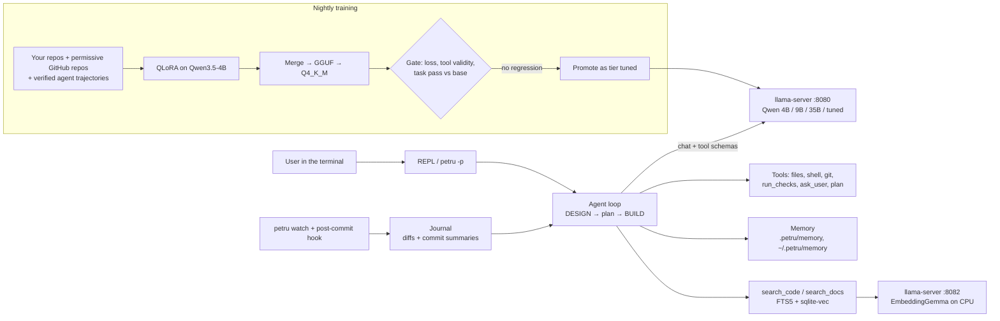

# PetruAI

A local, offline-first coding agent for the terminal, with its own fine-tuning pipeline.
It runs open-weight models through llama.cpp on a 6 GB laptop GPU, asks design questions before writing code,
follows the user's decisions, verifies its work with the project's own tests and commits when they pass.



## Why

Cloud coding agents need an internet connection and a subscription. PetruAI is built for working fully offline on a
mid-range laptop (RTX 4050 6 GB, 32 GB RAM), across Python, TypeScript and Flutter/Dart, and for getting better over
time by training on the user's own repositories.

## What it does

- **Two enforced phases.** Every new request starts in a DESIGN phase: the agent may only read the project and ask
  questions (`ask_user`), then proposes a plan. Writing tools unlock only after the user confirms the plan. The
  answers are appended to `.petru/DECISIONS.md` and treated as final. `/quick` skips the questions for small fixes.
- **Tools.** `read_file`, `write_file`, `edit_file` (exact search/replace, refuses ambiguous matches), `list_dir`,
  `glob`, `grep`, `search_code`, `search_docs`, `shell` (PowerShell, timeouts, process-tree kill), `git`,
  `run_checks` (detects pytest, npm test,
  tsc, dart analyze, flutter test), `ask_user`, `plan`, `task_complete`, `remember`, `recall`.
- **Safety.** Paths cannot escape the project root; shell commands are classified safe, unknown or dangerous; anything
  not clearly safe asks for confirmation (`--yolo` disables prompts).
- **Robust tool calling with small models.** Native tool calls with a text fallback (`<tool_call>` tags, JSON
  fences), JSON repair (including arguments that run into the markup of further calls), schema validation, a
  transcript that only ever holds canonical JSON (llama-server rejects a history with malformed arguments), bounded
  retries with rising temperature, guards against a model re-asking the same question, a cap on any tool result,
  exact token counting through the server and transcript compaction that never splits a tool call from its result.
- **Model tiers**, started and health-checked automatically:

  | Tier | Model (GGUF) | Where it runs |
  |---|---|---|
  | `default` | Qwen3.5-9B IQ4_XS | fully in VRAM |
  | `quality` | Qwen3.6-35B-A3B UD-IQ4_XS | MoE experts in system RAM |
  | `fast` | Qwen3.5-4B IQ4_XS | fully in VRAM |
  | `tuned` | Qwen3.5-4B fine-tuned by the pipeline below | appears once a model passes the gate |

- **Team mode** (`--team`): the 35B model leads and, after reading the task and its tests, decides whether the
  project needs the team. Working as a team, it keeps the hard parts and hands simple, self-contained pieces
  (records, exceptions, formatting, parsing helpers) to a faster assistant model that works in a fresh context,
  may write only the files it was given and cannot run shell commands. Each piece goes to the promoted specialist
  for the language of its files, else to the general fine-tune, else to the 4B, so a project in several languages
  is shared among several specialists. The lead verifies every delegated piece with the checks before it builds on it. The assistant's server
  starts on the first delegation, so a lead that works alone costs no extra memory.
- **Offline package caches** for generated projects: a Python wheelhouse, a pre-filled npm cache and a pub cache
  (`infra/offline/`), with the agent told which packages are available.

## Learning without retraining

- **Memory.** `remember` / `recall` write typed Markdown notes (user, feedback, project, reference) to
  `.petru/memory/` and `~/.petru/memory/`; their indexes go into the system prompt. Updates are append-only deltas,
  so a small model cannot erase what it learned. `petru memory export|import` moves them between machines.
- **Code index.** tree-sitter chunks (functions, classes, methods; 20 languages) in SQLite with FTS5 (BM25) and
  sqlite-vec (EmbeddingGemma 2 vectors on a CPU llama-server), fused by reciprocal rank; `search_code` refreshes it
  incrementally before each search. `search_docs` does the same over the Flutter SDK source and offline docs.
- **Journal.** `petru watch` records every save as a diff; a git post-commit hook queues commits, and the local
  model writes a 2–4 line "what and why" summary per commit, shown in the prompt and under `/journal`.

See `docs/memory.md`.

## Training pipeline (`training/`)

An autonomous, resumable nightly pipeline (Python 3.12, Unsloth + TRL) over 182 permissively licensed
repositories in every in-demand language plus the user's own:

1. **Data.** Commits of the user's repositories and of the permissively licensed GitHub repositories (license
   verified through the GitHub API; copyleft and unknown licenses excluded) become read/edit/complete tool
   trajectories. Filters drop generated files, lockfiles, secrets, trivial messages and oversized changes; MinHash
   deduplication and per-language balancing follow. Verified trajectories of the local models solving scripted tasks
   (kept only when all checks pass) are mixed in, normalized to the agent's protocol (a question written as text
   becomes an `ask_user` call, harness nudges and rejected calls are dropped) and split into a DESIGN and a BUILD
   sample, each under the system prompt the agent had in that phase. No output of any proprietary model is used.
2. **QLoRA** on Qwen3.5-4B in 4-bit with assistant-only loss, checkpoints, automatic resume and a time budget.
3. **Export**: adapter merge, conversion to GGUF and Q4_K_M quantization.
4. **Gate**: the candidate is promoted only if it does not regress against the base model on held-out loss
   (assistant tokens), tool-call validity on fixed requests and the pass rate on harness tasks.

5. **Language specialists**: after the generalist, the night trains specialists in rotation (Python, Python web,
   Python data, web/TypeScript, Flutter, JVM, .NET, C/C++, Go, Rust, PHP, Ruby, Swift, R, scripting), each on its
   share of the data and gated against the base model on its own tasks. Promoted ones become tiers
   `tuned-<name>`; `petru --model auto` picks the one that matches the project.

Each heavy step runs in its own process so the GPU is fully released between steps. A scheduled task runs the
whole pipeline every night on AC power. See `docs/training.md`.

## Install (Windows, NVIDIA GPU)

```powershell
git clone https://github.com/PeTruStEfAN21/PetruAI.git
cd PetruAI
powershell -ExecutionPolicy Bypass -File infra/setup.ps1 -DryRun   # shows what it would do
powershell -ExecutionPolicy Bypass -File infra/setup.ps1           # installs what is missing
```

The script reads the GPU and RAM, installs `uv`, creates the environment, downloads the llama.cpp `b11877` CUDA
binaries and the models that fit the card (4B always, 9B from ~6 GB VRAM, the 35B MoE with `-IncludeQuality` and
24 GB RAM), puts `petru` on PATH and runs `petru doctor`, which checks every dependency and the offline caches and
prints the fix for anything missing. Details: `docs/setup.md`.

## Quick start

```powershell
py -3.14 -m uv sync
py -3.14 -m uv run petru                     # full screen in the current folder, tier "default"
py -3.14 -m uv run petru --plain             # the same session, line by line
py -3.14 -m uv run petru --model fast -p "Create hello.py that prints the date"   # one-shot
py -3.14 -m uv run petru --team              # the 35B leads a two-model team
```

Petru tells you in a sentence what it starts and why, asks when a decision is yours, and ends a task with a
short summary. The full screen keeps the conversation on the left and a panel with the plan, the changed files,
the team and the model on the right (F2 hides it). The top bar switches model, team, thinking and confirmations
with a click. Esc stops the current step, including a reply still being computed and any test run it started.
Typing while Petru works hands it the message at its next step.

Slash commands: `/help`, `/model [tier|auto]`, `/plan`, `/quick <text>`, `/done`, `/yolo`, `/think`, `/status`,
`/details`, `/team`, `/memory`, `/journal`, `/exit`. Subcommands: `petru index [--docs]`, `petru watch`, `petru journal hook install`,
`petru memory export|import`.

## Tests

```powershell
py -3.14 -m uv run pytest -q                              # agent unit tests
$env:PETRU_E2E = "1"; py -3.14 -m uv run pytest -m e2e    # live demos with the real model and a scripted user
cd training; py -3.14 -m uv run pytest -q                 # training pipeline unit tests
$env:PETRU_GPU = "1"; py -3.14 -m uv run pytest -q -m gpu # GPU tests (QLoRA steps, evaluation)
```

End-to-end demos from an empty folder (design questions, plan, build, checks, commit), measured on the laptop with
the 9B tier: a Python todo CLI with pytest (about 2 minutes) and a Flutter counter app with widget tests (about
3 minutes). Measurements are in `docs/benchmarks.md`.

Projects the team (the 35B leading, the 4B assisting) built in a 12-project bench, each with who wrote which
file: `showcase/`.

## Layout

```
petru/        the agent: cli, tui, agent loop, phases and permissions, tools, providers, llama-server manager
training/     dataset building, trajectories, QLoRA training, evaluation gate, GGUF export, nightly orchestrator
infra/        llama.cpp (binaries and models not in git), benchmarks, offline package caches
docs/         benchmarks, demo guide, training guide
research_notes/  notes with sources on local models, agent harnesses, memory and fine-tuning
tests/        unit tests and live end-to-end demos
```

## Status and roadmap

Done: the agent (phases, tools, permissions, TUI, model tiers), the training pipeline, project and global memory
with export/import, the hybrid code index, the offline docs index, the change journal, a one-script setup and
`petru doctor`. Next: the first promoted fine-tuned model.
